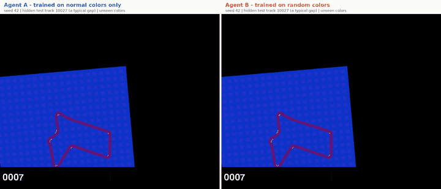
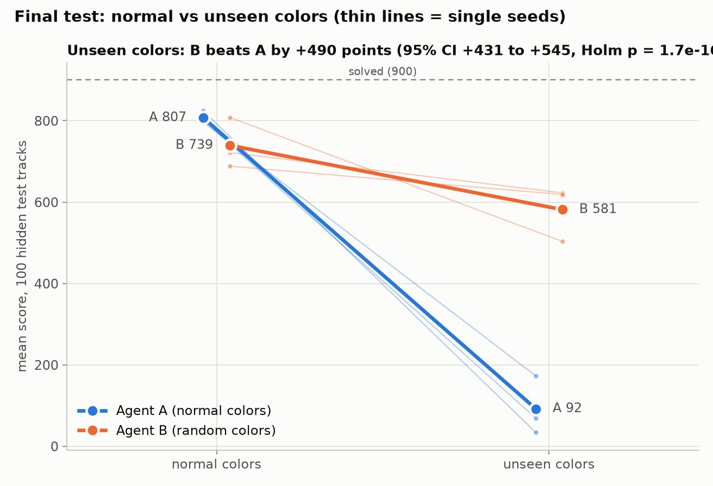
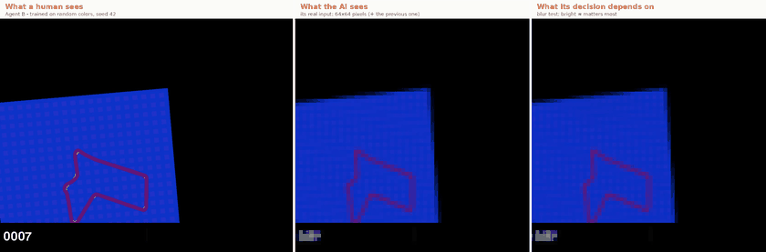
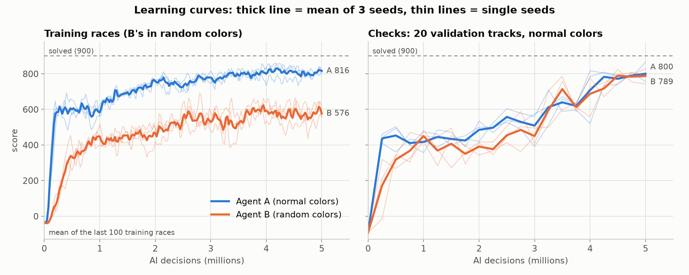
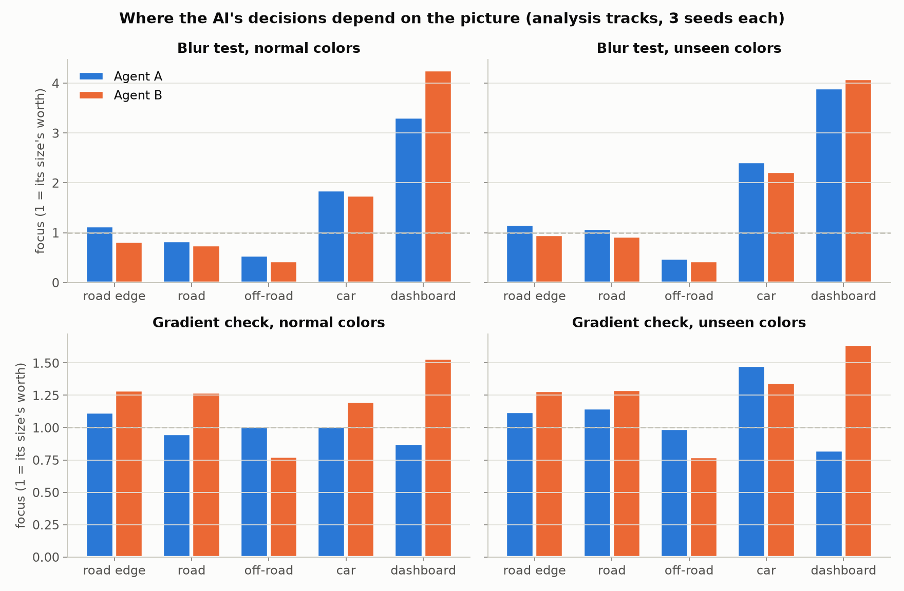
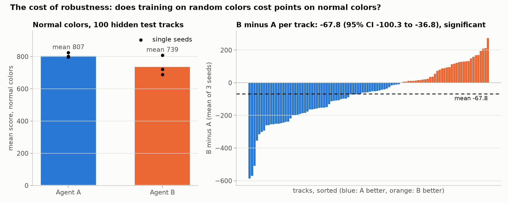

# Same Road, New Colors: does a pixel-driving AI survive colors it has never seen?

**Live demo: [s4dai-same-road-new-colors.static.hf.space](https://s4dai-same-road-new-colors.static.hf.space)**. Race A against B on any of the 100 hidden test tracks: replays of the recorded test races, in your browser.



*Same hidden test track, same new colors (purple road, blue grass), same training seed. Left: Agent A, which only ever practised with the normal grey road and green grass, loses the road, wanders across the grass and leaves the map after 9.5 seconds (score 139). Right: Agent B, which practised with a new random color scheme in every race, follows the track (score 745). A real test race, replayed exactly. ▶ [Full video](results/final_test/videos/3_a_vs_b_unseen_colors.mp4)*

---

A race-car AI teaches itself to drive in Gymnasium's **CarRacing** using **only what it sees on screen**: a small top-down camera picture. No map, no track data, no human examples, just trial and error and the game's score.

The main experiment asks one question: **an AI trained on one look of the world breaks when the colors change. Does training with a new random color scheme in every practice race ("domain randomization") fix that?**

- **Agent A** practised only with the normal colors: grey road, green grass.
- **Agent B** practised with a new random road, background and grass color in every race.
- Everything else was identical: the same learning method and settings, the same practice (5 million decisions), the same 3 training seeds.

---

## Results at a glance

On the **final test** (100 hidden tracks × 3 training seeds = 300 races per agent per color set, run exactly once):

| Mean score (a full lap ≈ 900) | A: normal colors only | B: random colors in practice |
|---|---|---|
| **Unseen colors** | **92.0** | **581.4** |
| Normal colors | **807.1** | 739.3 |
| Track covered, unseen colors | 20.1% | 69.1% |
| Left the map, unseen colors | 19.7% | 17.0% |
| Practice | 5,000,000 decisions | 5,000,000 decisions |

- **B handles new colors far better. Proven:** +489.5 points on unseen colors (95% CI +431 to +545), better on 93 of 100 tracks (paired Wilcoxon signed-rank test, Holm-corrected p = 1.7e-16). Every B seed (503–623) beats every A seed (34–173).
- **A breaks on new colors:** from 807 to 92 (worse on 99 of 100 tracks). It drives off the road at the first bend it can't recognize.
- **Robustness has a price. Proven, but small:** on the normal colors, B scores 67.8 points less than A (95% CI −100 to −37, p = 0.0002).
- **B is robust, not immune:** it still loses 158 points on new colors compared to normal ones.
- **Neither is "solved"** (an average of 900). On normal colors, A seeds 42 and 242 and B seed 242 pass the 800 mark I set for myself; the others don't.
- **What they look at** (heat maps): A pays more attention to the grass and background than B (both methods agree). Both lean surprisingly hard on the dashboard gauges at the bottom of the screen.

All verdicts follow rules written down and committed before the test ([test plan](results/final_test/TEST_PLAN.md)). The analysis tracks, used before the test, gave the same picture (+479.7 and −41.6).



---

## How this was built

Built over about six days (October 16–22, 2026) on a gaming PC: AMD Ryzen 9 5900X, NVIDIA RTX 3080 (12 GB), Windows with WSL Ubuntu. The PC was shared with other apps, so jobs ran at low priority, one at a time, with a memory guard that paused my work whenever free memory dropped under 3 GB.

**Workflow:** I directed the project. I chose the experiments, made every decision, and set the fairness rules before the results came in. Each step ended with my review before the next one started (the last steps ran in one go, with every decision and its reason written into the lab notebook). The decisions I made along the way:
- **Fairness rules, set up front:**
  - Equal practice for both agents, 3 training seeds each (42, 142, 242).
  - Separate tracks for checking (validation), comparing (analysis) and the final test, with the test hidden until the end and used once.
  - Paired statistical tests; nothing called "proven" without one. Bad results reported as clearly as good ones.
  - Judging rules written down and committed before each experiment ran.
- **Color input, not grayscale:** the usual CarRacing setup turns the picture grey, which would hide the very thing the experiment is about.
- **Continuous controls** (smooth steering, gas and brake) over 5 discrete buttons.
- **When the first recipe failed:** Agent B never learned to drive with the standard RL Baselines3 Zoo settings. Instead of patching them, I asked for research on what has actually reached ~900 on CarRacing, and chose a published recipe (PPO with a Beta policy and one pedal, Petrazzini & Antonelo 2021), with a fallback for B written down in advance (Slaoui et al. 2020) and gates for when to switch or stop. The fallback wasn't needed.
- **What the AI looks at:** a blur test as the main heat-map method, with gradients as a check; a finding counts only if both agree.

**By the numbers**
- **61 million** practice decisions across 14 training runs (the 6 final agents: 5M decisions each, about 5.5–6 hours per run on the GPU).
- **1,300** races in the final test, plus about 9,000 evaluation races before it (validation and analysis tracks, and checks during training).
- **105,643** pictures turned into heat maps (two methods each), each checked: the replayed picture gives the recorded decision.
- **9** videos of real test races at the game's full resolution and 50 frames per second, each replayed from the recorded actions and checked against its recorded score.
- About **4,800 lines** of Python in 39 files, and a website of about 740 lines.

**Techniques**
- **Deep reinforcement learning:** PPO (Stable-Baselines3, PyTorch) with a **Beta-distribution policy** for bounded steering and pedal, gas and brake merged into one pedal, the published settings of Petrazzini & Antonelo (2021), and an image network on 64×64 color pictures with 2 stacked frames.
- **Domain randomization** that changes only the colors: the official game draws its random colors from the same random stream as the track, so turning them on also changes the track. I rebuilt it with a separate color seed: same track, any colors, every race reproducible.
- **Rigorous evaluation:**
  - Separate validation, analysis and hidden test tracks; Wilcoxon signed-rank tests on paired tracks with Holm correction; bootstrap confidence intervals.
  - A test plan committed to git before the one-shot final test, and a script that refuses to run twice or with uncommitted changes.
  - Judging rules committed before every experiment: a gated retraining plan (switch B's method or stop, decided by validation scores) and the heat-map comparison.
- **Reproducibility:** training resumes bit-for-bit after a crash or a hard kill (checked by killing runs on purpose). Every evaluation records every action; every replay, chart, video and website race is checked against the recorded score.
- **Explainability:** blur-test saliency (Greydanus et al. 2018) and gradient maps, measured per image region (road edge, road, off-road, car, dashboard) using the game's own geometry, plus a sanity check against an untrained network (Adebayo et al. 2018).
- **Visualization:** colorblind-safe charts; videos that replay recorded races; a website with a top-down replay of every test race.

---

## The setup, in plain words

- **What the AI sees:** the game's 96×96 top-down camera picture, shrunk to **64×64 pixels**, in color. It gets its last 2 pictures, so it can tell speed and direction. The black bar at the bottom of the picture is the game's dashboard: speed, wheel spin, steering and turning gauges.
- **What it controls:** **steering** and **one pedal** (above zero = gas, below zero = brake). It decides 25 times a second.
- **The score** is the game's official reward:
  - +1000/N for each of the N road tiles it touches for the first time (about +3.4 each).
  - −0.1 for every frame (50 per second), so dawdling costs points.
  - −100 for leaving the map (the race ends).
  - A race lasts at most 20 seconds. A lap that touches every tile scores about 900, the official "solved" mark.
- **How it learns:** it drives, gets the score as feedback, and slowly adjusts its "brain" (a neural network) to do more of what scored well. 5 million decisions is about 55 hours of driving at game speed, done in about 6 hours on the GPU.
- **Fairness:**
  - Track seed *t* always builds exactly the same track, so both agents race on identical tracks.
  - Color seed *c* always gives the same color scheme. B practised on color seeds 1,000,000–1,999,999; the "unseen colors" tests use color seeds below that range, so no AI had ever seen them.
  - Track sets kept apart: validation 5000–5099, analysis 20000–20099, hidden test 10000–10099 (used once, at the end).



*Left: what a human sees. Middle: what the AI actually gets, 64×64 pixels. Right: the blur-test heat map (bright = its decision depends on that part). Agent B on a hidden test track in unseen colors.*

---

## Step 1 → 2: the first driver, and a recipe that failed

- **Step 1** checked the setup: our two-seed game is pixel-for-pixel identical to the official one in normal colors, and the AI's view (shrink to 64×64, stack 2 pictures) works as intended.
- **Step 2** trained Agent A with the RL Baselines3 Zoo's CarRacing settings. The first run learned fast (743 on its checks after 500k decisions), then **collapsed** (388 at 1.25M): its exploration noise shrank to almost nothing and it stopped turning at corners. I tested two one-setting fixes side by side and picked the winner (an entropy bonus) on validation tracks only.
- With that recipe, A averaged 525 on the analysis tracks (seeds: 781, 152, 642), so the seeds disagreed wildly.

## Step 3, first try: B never learned to drive

With the same recipe, **Agent B never learned to drive at all**, in any colors (19 on normal colors, 32 on unseen ones). The pre-planned color test was still significant for B (+30), but only because B failed more gently than A. It couldn't answer the question.

So I asked for research instead of a patch: which published methods actually reach ~900 on CarRacing, with how much training, and what fits this PC. The evidence pointed to **PPO with a Beta policy and gas and brake merged into one pedal** (Petrazzini & Antonelo 2021). Their paper says learning "would not take place" without the merged pedal. I wrote the retraining plan with gates before training:
- A seed 42 must reach 500 on validation (it reached 778.9).
- B seed 42 must "be able to drive" (100+), otherwise switch B to Slaoui et al.'s method automatically (B reached 728.1, so no switch).
- Two seeds each: B at least 300 and clearly better than the old B, A not much worse than the old A (B 723.8 vs −12.2, A 792.8 vs 475.7: passed).



*B's training races (left) score lower than its normal-color checks (right). Likely reason (untested): some random color schemes are hard, for example a road and grass of similar colors.*

## Step 3 again: the color test with drivers that can drive

On the 100 analysis tracks, with the pre-planned four paired tests (Holm-corrected):

| Mean of 3 seeds | A normal | A unseen | B normal | B unseen |
|---|---|---|---|---|
| Analysis tracks | 798.8 | 51.0 | 757.2 | 530.6 |

On analysis track 20000 in the same unseen colors, A (seed 42) drives straight on at the first bend and off the map after 4.4 seconds; B follows the whole track. Over all 100 tracks, B was better on 96 (p = 4.2e-17).

## Step 4: what the AI looks at

Blur one small patch of the AI's picture at a time and measure how much its steering and pedal change: that is a heat map of what its decision depends on (the blur test). Gradients (how much a tiny change of each pixel moves the decision) are the check. I measured the heat in five regions using the game's own geometry, on 105,000 pictures from the analysis tracks, and wrote the judging rule down first.



- **"A looks at the background more than B": supported.** Both methods agree, on normal and unseen colors.
- **"B looks at the road edges more": not shown.** The two methods point in opposite directions, so by the rule it isn't claimed.
- **The surprise: both lean hard on the dashboard.** In the blur test, the black bar at the bottom (12.5% of the picture) gets 41–53% of the heat, B more than A. The gauges (speed, wheel spin, steering, turning) look the same in any colors. A likely reason (untested) that this helps B: it can lean on color-free signals.
- **Sanity check:** an untrained network's blur maps already resemble the trained one's (rank correlation 0.71), because blurring only changes something where the picture has edges. What the AI learned shows in the differences: dashboard attention goes from 1.1× to 3.3× its size's worth.

## Step 5: review

Before the final test I re-ran all 24 code checks, confirmed the hidden test tracks had never been touched, and tried every tool that would touch them (the one-shot test script, the videos, the charts and the website export) **for real on scratch tracks in a separate copy of the project**. Nothing was broken, so nothing was retrained.

## Step 6: the final test

See [Results at a glance](#results-at-a-glance). Run once, on October 22, 2026, from a plan committed before the test tracks were ever used.



---

## Bugs and surprises found along the way

1. **The official color randomizer also changes the track.** Gymnasium picks random colors from the same random stream that builds the track. Fixed by giving colors their own seed, checked pixel for pixel against the official game.
2. **A Windows Update restart killed training at 2 AM.** I built exact resume: the simulator's state is rebuilt by replaying the current race from its recorded actions, so a resumed run ends bit-for-bit identical to one never stopped (checked with deliberate hard kills).
3. **"Slow driving" was partly a game rule.** The game says a lap ends early when 95% of the tiles are touched and the car crosses the start. But the start tile already counts as touched when the race begins, so that rule never fires (checked in 20 of 20 races): a car that skips even one tile drives on until the 20-second limit, losing 0.1 points per frame. The new agents are fast enough; they lose points by missing a few tiles.
4. **My own gate script crashed** after making the right decision (Python's JSON writer refused a NumPy true/false), which stopped the unattended plan for a few minutes. My dry runs had used stand-ins for that script. Lesson applied from then on: every tool is tried for real before it matters.
5. **GPU rounding.** The check that a rebuilt picture gives the recorded decision failed at a gap of 0.00012, and after I widened it, at 0.0011. The cause was the GPU's fast math mode (TF32), which makes results depend slightly on batch size. Measured: rounding stays under 0.005, while a wrong picture is off by about 0.4, so the check limit became 0.01.
6. **Model files carried this PC's folder paths** (Stable-Baselines3 saves the log folder and the learning-rate schedule as code). The published models are cleaned copies, checked to make exactly the same decisions.

## Limits, honestly
- **3 training seeds per agent.** The tests compare these six drivers on 100 tracks; they can't say how much a fresh training run would vary.
- **"Unseen colors" means new schemes from the same random formula B practised with.** Other changes (lighting, textures, a different color formula, the real world) weren't tested.
- **Robust, not immune:** B still loses 158 points on new colors, and it pays 68 points on normal colors.
- **Not solved:** no agent averages 900. Most races end at the time limit because of the lap rule above.
- **The first recipe failed for B,** and only one recipe was tried after that.
- **Heat maps are a partial view:** the two methods disagree on road edges, and the dashboard explanation is untested.

---

## Videos
All in [`results/final_test/videos/`](results/final_test/videos/): the game's full 1000×800 picture per view, 50 frames per second, H.264.
- **Picked by rules written down before the test** ([test plan](results/final_test/TEST_PLAN.md)).
- **Checked:** each replays a recorded final-test race and was kept only if it matched its recorded score exactly ([manifest](results/final_test/videos/manifest.json)).

| Clip | What happens |
|---|---|
| [`1_untrained_car.mp4`](results/final_test/videos/1_untrained_car.mp4) | The untrained car with random actions: it jitters and creeps, because random gas and brake cancel out (score −49) |
| [`2_agent_a_normal_colors.mp4`](results/final_test/videos/2_agent_a_normal_colors.mp4) | Agent A's best race of its best seed: a full lap in 12 s (score 940) |
| [`3_a_vs_b_unseen_colors.mp4`](results/final_test/videos/3_a_vs_b_unseen_colors.mp4) | Same track, unseen colors, the track with the median gap: A leaves the map after 9.5 s (139), B drives on to the time limit (745) |
| [`4_split_screen_what_the_ai_sees.mp4`](results/final_test/videos/4_split_screen_what_the_ai_sees.mp4) | What a human sees, the AI's real 64×64 input, and its heat map |
| `5_broll_1` … `5_broll_5` | Clean 10-second clips: B on three unseen color schemes, A and B on normal colors |

The Step 4 heat-map videos (analysis tracks) are made by `scripts.attention_video`.

---

## How to run it

```bash
# Python 3.11, an NVIDIA GPU, and uv (https://docs.astral.sh/uv/)
uv venv --python 3.11 .venv && uv pip install --python .venv/bin/python -r requirements.txt
.venv/bin/python -m scripts.step1_smoke_test        # checks: our game = the official one, pixel for pixel; colors; determinism
.venv/bin/python -m scripts.test_beta_recipe        # 24 checks of the recipe (Beta policy, pedal, exact replays)
.venv/bin/python -m scripts.restore_models          # put the included models and recorded test races in place
```

Re-running everything (times on an RTX 3080 with 8 simulators):

| What | Command | Time |
|---|---|---|
| Train one agent | `scripts.train --agent A --seed 42 --recipe beta` (B: `--agent B`) | ~6 h each |
| Evaluate | `scripts.evaluate_agent --agent A --tracks analysis --colors normal unseen` | ~2 min per seed and color set |
| Color test | `scripts.compare_agents --out-dir results/step3_beta` | seconds |
| Heat maps | `scripts.attention_maps`, then `scripts.compare_attention`; videos: `scripts.attention_video` | ~30 min, seconds, ~2 min |
| Final test (once only) | `scripts.final_test` (refuses to run twice) | ~30 min |
| Charts, videos | `scripts.make_charts`, `scripts.make_videos` | seconds, ~4 min |
| Website data (replays all 1,200 test races, checked) and the Space | `scripts.export_site_data`, then `scripts.make_space` (`--push USER/SPACE`) | ~17 min, seconds |

The trained models are in `models/` and every test race's actions in `results/final_test/actions/`, so the videos, charts and website can be re-made without training.

## Project layout

| File | What it does |
|---|---|
| `config.py` | Every setting: tracks, seeds, colors, recipes, budgets, fairness rules |
| `racecar/envs.py` | The game with separate track and color seeds; the AI's view (shrink, stack, one pedal) |
| `racecar/beta_policy.py` | The Beta-distribution policy (and the unused fallback, Slaoui's method) |
| `racecar/train_utils.py`, `scripts/train.py` | Training with checkpoints and exact resume |
| `racecar/evaluate.py`, `scripts/evaluate_agent.py` | Evaluation on chosen tracks and colors, recording every action |
| `racecar/replay.py`, `scripts/inspect_driving.py` | Exact replays; driving-style measurements and contact sheets |
| `scripts/compare_agents.py` | The paired color tests (Step 3 and the final test) |
| `racecar/attention*.py`, `scripts/attention_maps.py`, `scripts/compare_attention.py` | Heat maps (blur test, gradients), image regions, the Step 4 tests |
| `scripts/final_test.py`, `results/final_test/TEST_PLAN.md` | The one-time final test, and its plan committed before it ran |
| `scripts/make_charts.py`, `scripts/make_videos.py`, `racecar/video.py` | Charts; videos that replay recorded test races |
| `web/`, `scripts/export_site_data.py`, `scripts/make_space.py` | The website; its data (every test race, replay-checked); packing it as a Hugging Face Space |
| `scripts/run_plan.sh`, `scripts/plan_gate.py`, `scripts/job_queue.sh`, `scripts/memory_guard.py` | The gated retraining plan; the one-job-at-a-time queue; the 3 GB memory guard |
| `scripts/export_models.py`, `scripts/restore_models.py`, `models/` | The published (cleaned) models, and putting them back in place |
| `results/` | Every result file, chart and test report |
| `PROGRESS.md` | The full lab notebook: every step, decision, miss and number |
| `INTERVIEW.md` | Ten questions about the project, answered plainly |

## Credits

- Simulator: [Gymnasium](https://gymnasium.farama.org/) CarRacing-v3 (Box2D). Learning: [Stable-Baselines3](https://stable-baselines3.readthedocs.io/) and PyTorch.
- Recipe: A. Petrazzini and E. Antonelo, "Proximal Policy Optimization with Continuous Bounded Action Space via the Beta Distribution" (2021). First settings: [RL Baselines3 Zoo](https://github.com/DLR-RM/rl-baselines3-zoo).
- Fallback method (not needed): K. Slaoui et al., "Robust Visual Domain Randomization for Reinforcement Learning" (2020).
- Heat maps: S. Greydanus et al., "Visualizing and Understanding Atari Agents" (2018); sanity check after J. Adebayo et al., "Sanity Checks for Saliency Maps" (2018).
- Website: Geist and Geist Mono by Vercel (SIL Open Font License); GSAP by GreenSock (standard "no charge" license).
- License: MIT (see [`LICENSE`](LICENSE)).
